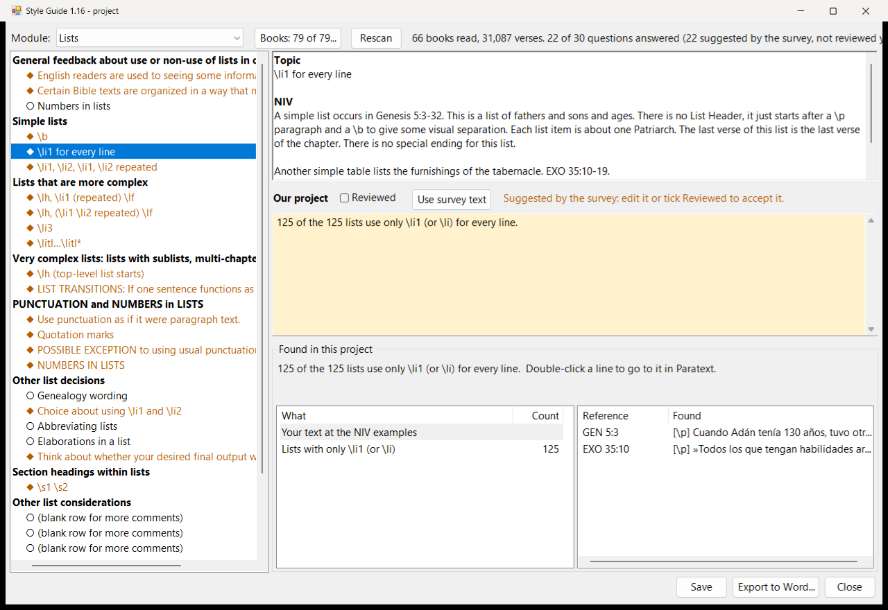

# Style Guide

*This page is the English user guide, [StyleGuide_UserGuide.rtf](plugin/StyleGuide_UserGuide.rtf).*

## Purpose

Style Guide is a Paratext plugin that helps a translation team fill in Biblica's style-guide modules. Each module is a Word document that lists topics (punctuation, footnotes, headings and so on), says what the NIV does, and leaves a yellow "Our Project" column for the team to describe its own practice.

The plugin reads the project's text and settings, works out what the project already does, and suggests an answer for every question it can. The team checks each suggestion, corrects or completes it, answers the remaining questions, and exports the filled-in Word document. The plugin never changes the project's text.

## The modules

- Punctuation
- Footnotes
- Headings
- Hyphenation
- Lists
- Numbers, Weights, Measures, Time
- Poetry
- Quotations
- Syntax, Grammar, Spelling
- Letters, Proclamations (draft)
- Markup and Layout (draft)
- Translation Considerations (draft)

The last three are drafts from Biblica; their questions may change in later versions of the documents. Some questions, such as those about grammar, the audience or the type of translation, cannot be answered from the text: the plugin says so, and the team answers them.

## Installing

1. Download Install_Phils_tools.exe from the Paratext_Plugins folder. If your browser warns about the file, choose to keep it.

2. Close Paratext.

3. Double-click Install_Phils_tools.exe. If Windows says it protected your PC, click "More info", then "Run anyway" (the installer is not signed yet).

4. Tick Style Guide and click "Install / update ticked". It installs into every Paratext 9 on the computer. If Windows asks for permission, click Yes. The same window updates the plugin later (its status then says "Update available") or removes it ("Remove ticked"), and its "User guide" button opens this guide.

## Opening the window

Open the project in a Scripture window and choose Tools > Style Guide... The window opens and starts surveying the first module, Punctuation. While the survey runs, the line to the right of Rescan is orange and bold. Each module is surveyed the first time you choose it, which takes a few seconds (up to about 15 seconds for a large project).

## The window

- Module (top left): chooses the module. Each module has its own answers.
- Books: n of m... chooses the books to survey (see "Choosing the books" below).
- Rescan reads the books again and surveys again. Use it after changing the text. When the text changes in Paratext while the window is open, the status line reminds you to rescan.
- On the left, the module's questions, grouped by the sections of the Word document. The mark before each question shows its state: an empty circle = no answer yet; an orange diamond = suggested by the survey, not reviewed yet; a green dot = reviewed by the team.
- Topic and NIV (top right): the question and what the NIV does, as in the Word document.
- Our project (yellow): your answer. A suggestion from the survey has one sentence per line.
- Found in this project: what the survey found. The list on the left gives the patterns found and how many times; click one to see its examples on the right. "Your text at the NIV examples" shows the project's text at the verses the module gives as examples. Double-click an example to go to that verse in Paratext.

## Answering

1. Click a question on the left.

2. Read the suggestion in the yellow box and the findings below it. The survey counts what the text does; it cannot know what the team intends. Where the text is not consistent, the suggestion gives the numbers so the team can decide.

3. Correct or complete the answer, or type your own. Typing in the box, or ticking Reviewed, marks the answer as reviewed (green).

4. Use survey text puts the survey's suggestion back in the box.

Answers are saved when you move to another question, when you click Save and when you close the window. When the survey runs again (Rescan, a different choice of books), answers that are still only suggestions are replaced by the new suggestions; reviewed answers are never changed.

## Choosing the books

A project may have all 66 books while the style guide should describe only the New Testament, or the books drafted so far. Click Books: n of m... and tick the books to survey. The buttons on the right tick a group at once: All, None, Bible books, Old Testament, New Testament, Deuterocanon, Other books. Click OK.

The choice is the same for every module and is kept for the next time. The books are read again and the module is surveyed again. Books that are not ticked are not read at all, so the survey is also faster. The status line then says, for example, "27 of 66 books read (your choice)".

Some questions look at particular places, such as the lists in Genesis or the end of each Book of Psalms. When such a place is in a book that was not chosen, the findings say "book not surveyed" instead of "not drafted".

## Exporting to Word

Click Export to Word... to save a copy of the module's Word document with the team's answers in the yellow "Our Project" column, one paragraph per line. If some answers are still unreviewed suggestions, the plugin asks whether to include them: Yes includes them, No leaves those cells empty. The file name offered is "&lt;language> &lt;module> Module (&lt;project>).docx", in your Documents folder. After saving, the plugin offers to open the file.

The rest of the document (introduction, NIV column, formatting) is Biblica's original. Text that the form already had in a yellow cell (for example "Yes or No: \_\_\_\_") is kept, with the answer after it.

## Where the answers are kept

The answers are saved in the project folder, in local\StyleGuide\\&lt;module>.xml (for example local\StyleGuide\Punctuation.xml), and the choice of books in local\StyleGuide\settings.xml. Send/Receive does not share the local folder, so each computer has its own answers. To share the team's answers, export the Word document and send it.

## What the survey looks at

- Punctuation: sentence-final marks, opening ¿ ¡, commas (including the serial comma), semicolons, colons, dashes, parentheses, brackets, ellipses, slashes, abbreviations and spacing before punctuation.
- Footnotes: kinds of footnotes (variants, literal meaning, wordplay...), the doubtful verses, the parts of each note (\fr \ft \fq \fqa) and where the callers are placed.
- Headings: book names (\toc1-3, \h, \mt, BookNames.xml), section headings (length, capitalization, punctuation), introductions and outlines.
- Hyphenation: the project's list of hyphenated words (hyphenatedWords.txt) and the patterns of the words the team has approved.
- Lists: list paragraphs (\li, \lh, \lf...), the places where the NIV uses a list, item punctuation, tables and ancient measures.
- Numbers: the number settings, numbers in digits or in words in each context, ordinals, times and measures.
- Poetry: poetic lines (\q1 \q2...), stanzas and \b, lead-in lines, Psalms (titles, Books of Psalms, acrostics) and Proverbs.
- Quotations: the quotation marks of each level, continuers in later paragraphs, and quotation dashes.
- Syntax: letters and diacritics, words written in two ways, capitalization, apostrophes and questions.
- The draft modules: renderings of names and key terms from the project's Biblical Terms, and counts of markers and verse bridges.

For Spanish, French and Portuguese projects (by the language code in the project settings), the survey also recognizes number words, conjunctions and the wording of footnotes. For other languages it relies on the marks and markers.
